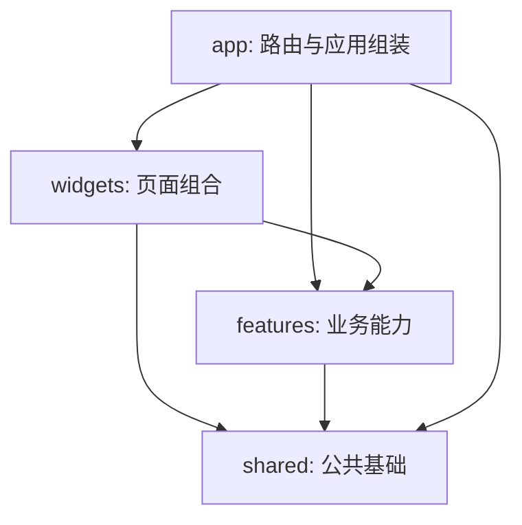

# 架构与国际化规范

本文描述当前代码已经落实的分层与检查，不将尚未实现的业务模块视为完成。

## 目录与职责

```text
src/
  main.tsx                     # 初始化国际化并挂载 React
  app/
    App.tsx                    # 路由、登录保护、业务模块组装
    Providers.tsx              # QueryClient、Session、Router
    layout/                    # 管理后台导航与外壳
    styles/                    # Web 端统一 Token 与全局样式
  widgets/
    resource-page/             # 组合表格、筛选、动作表单、选择器
      ResourcePage.tsx         # 列表展示与页面状态
      ActionForm.tsx           # 操作弹窗与提交状态
      FormFields.tsx           # 表单控件组合
      queries.ts              # 查询键、刷新、提交和必填校验
    im-management/            # 群成员、关系链页面组合
    notifications/            # 通知账号、选人、媒体上传、发送结果组合
    account/                  # 资料、头像上传、密码表单组合
  features/
    auth/                      # 登录页面与登录 API
    business/                  # 业务用户、封禁、默认好友/群组
    im/                        # IM 用户、群组、消息、日志
    notifications/             # 通知账号与发送协议
    account/                   # 管理员资料与密码 API
    releases/                  # 应用版本协议、校验、列表
    monitoring/                # 原 Grafana 访问入口
    directory/                 # 用户/群组搜索选择及响应适配
    files/                     # 签名上传、图片/视频元数据、视频封面
  shared/
    api/                       # HTTP 信封、Token 分流、错误类型
    session/                   # 会话结构、恢复、持久化、失效
    i18n/                      # 初始化、类型、语言控件、错误翻译
      locales/en.ts
      locales/zh-CN.ts
    resources/model.ts         # 通用列表/表单的类型契约
    lib/                       # 无 UI 依赖的日期、记录、ID 工具
    ui/                        # 按钮、弹窗、分页等通用控件
tests/
  unit/                        # 翻译、架构边界、接口契约
  e2e/                         # Playwright 中英文交互回归
```

业务模块中的 `types.ts` 定义请求/响应类型，`api.ts` 持有服务地址与协议字段，`resources.ts(x)` 将业务数据适配到简单列表。复杂流程应在所属模块编写独立组件，不继续扩充一个万能配置引擎。

目前 `business`、`im`、`notifications` 各自集中维护少量相关列表；以后按业务复杂度拆分，不为每个按钮建立目录。

## 依赖方向



- `shared` 不导入 `features`、`widgets` 或 `app`。
- `features` 不导入上层，也不直接导入其他业务模块。跨模块组合放在 `widgets` 或 `app`；真实共享的数据工具放在 `shared`。
- `api.ts` 不依赖 React、页面、表单配置或查询 Hook。它接收明确的请求类型和会话，返回服务数据。
- 页面不直接拼接 API 地址；列表只调用业务提供的 `load`、动作只调用 `execute`。
- 通用契约不从页面组件文件反向导出。业务配置只依赖 `shared/resources/model.ts`。
- 不允许循环依赖。以上边界由 `tests/unit/architecture.test.ts` 对静态导入和动态导入进行检查。

## 状态与请求

- 服务数据交给 TanStack Query，表单草稿、弹窗和选中项放在最近的组件状态中。
- 列表缓存键是 `resource / 稳定资源 ID / 管理员 ID / 筛选 / 页码 / 每页条数`。消息查询另外包含单聊/群聊及会话类型。不使用翻译后的标题，不把语言放进与语言无关的服务请求。
- 语言切换不重建表单、不清空选择器、不发起写操作。日期在渲染时按当前语言格式化。
- 登录服务负责请求和响应校验；共享 SessionProvider 负责会话状态。退出或 Token 失效时清空会话和查询缓存。
- API 层校验响应信封，区分异常 HTML、服务错误和正常数据。域字段以当前后端类型为准；涉及不可信或可变输入时，在对应模块添加必要的运行时校验。
- 错误保留结构化类型及参数，UI 渲染时翻译。服务端返回的业务说明原样保留，不把未知说明自动翻译或覆盖。
- 上传使用签名表单、对象存储上传、服务端完成确认；只有完整成功后更新表单 URL。上传中禁止提交和关闭，完成回调使用函数式状态更新，避免覆盖其他输入。

## 中英文约定

使用 `i18next` + `react-i18next`。首次访问优先浏览器语言，已选择过则优先持久化语言；支持 `zh-CN` 和 `en`，其他语言回退到英文。

1. 所有应用文案进入 `locales`，包括导航、标题、标签、按钮、提示、校验、无数据、错误、图标名称和分页。
2. 翻译键按 `nav`、`fields`、`actions`、`common` 等语义组织。不要使用中文原文作为键。
3. 配置保存翻译键，组件渲染时通过 `useTranslation()` 翻译。不要在模块加载时调用 `t()` 生成固定文案。
4. 句子用完整模板和插值，数量使用 i18next 复数规则；避免拼接“选择 + 用户”之类不适用于所有语言的短语。
5. `TranslationKey` 约束资源配置，i18next 类型扩展约束 `t()`，中文资源通过 `satisfies` 与英文保持同样的结构。
6. 用户昵称、消息内容、服务器业务说明、ID、URL 和品牌 `ABD IM` 不属于界面翻译。
7. HTML `lang`、浏览器标题和日期格式随语言更新。语言选项使用固定的母语名称，母语名称本身也放在资源文件。
8. 新增英文文案需要检查窄屏与长文本布局；不缩小到不可读的字号来掩盖溢出。

示例：

```tsx
// 业务配置
const action = { label: "actions.addDefaultFriends" as const };

// 界面
const { t } = useTranslation();
return <Button>{t(action.label)}</Button>;
```

## 新增模块步骤

1. 按原功能对等清单确认字段与行为。
2. 在所属业务模块定义 DTO、API 方法和必要的响应适配。
3. 简单列表实现 `Resource`；复杂交互使用独立组件。
4. 同时添加中英文键，然后在 `app` 注册路由和导航。
5. 对协议差异、状态恢复及危险动作增加针对性测试。
6. 执行 `pnpm check`，再做相应的真实服务联调；模拟测试不能代替服务端写入验收。

## 自动检查与边界

- TypeScript 检查 DTO、组件接口和翻译键。
- Prettier 统一文件格式。
- 架构测试检查层级方向、跨 feature 导入、API 对展示层的依赖及循环。
- 文案检查禁止资源目录以外的中文字符串和直接写在 JSX 中的普通英文文案。它不代替代码审查，仍需审查英文属性字符串和用户可见的新错误。
- 翻译测试比较键集合与插值变量，并验证复数、语言回退、日期和错误切换。
- 接口测试验证管理/IM Token 分流、ID 数组、更新包装字段、消息查询隔离和异常信封。
- Playwright 覆盖所有菜单、跨页选人、头像和通知图片/视频上传、群身份/群主转让、按平台下线、消息预览/撤回、通知部分失败/结果未知、版本、资料/密码、会话失效与移动深色布局。

通知的失败重试只提交明确失败的用户；结果未知时禁止在同一确认窗口盲目重发。`react-markdown` 负责 Markdown 渲染，`semver` 负责版本格式校验；外链只允许 HTTP(S)。

应用功能已经实现；生产写操作验收与服务器下载配置仍需部署环境配合，详见 `verification.md`。不把模拟测试记作生产数据联调。
